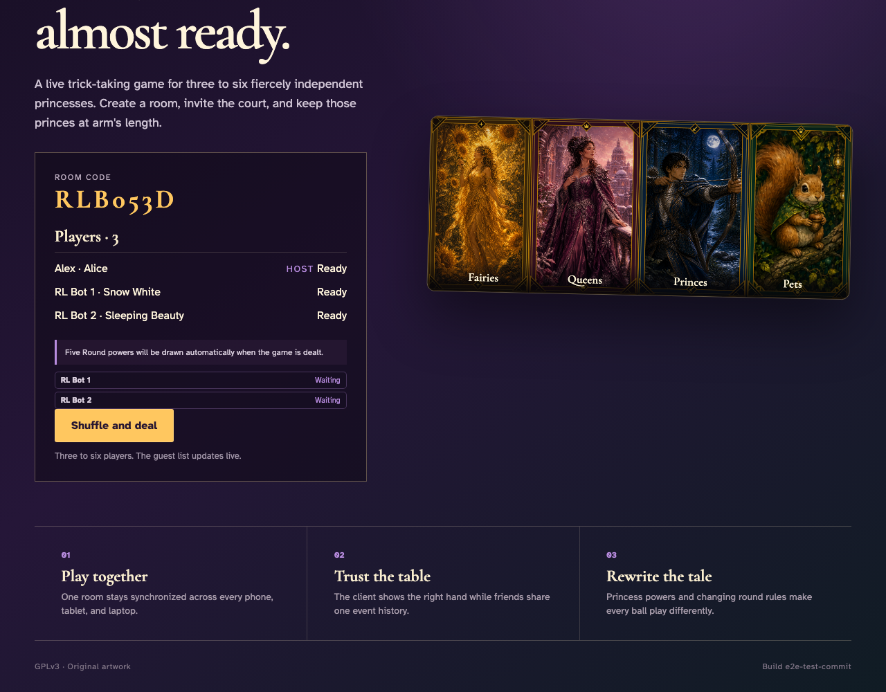
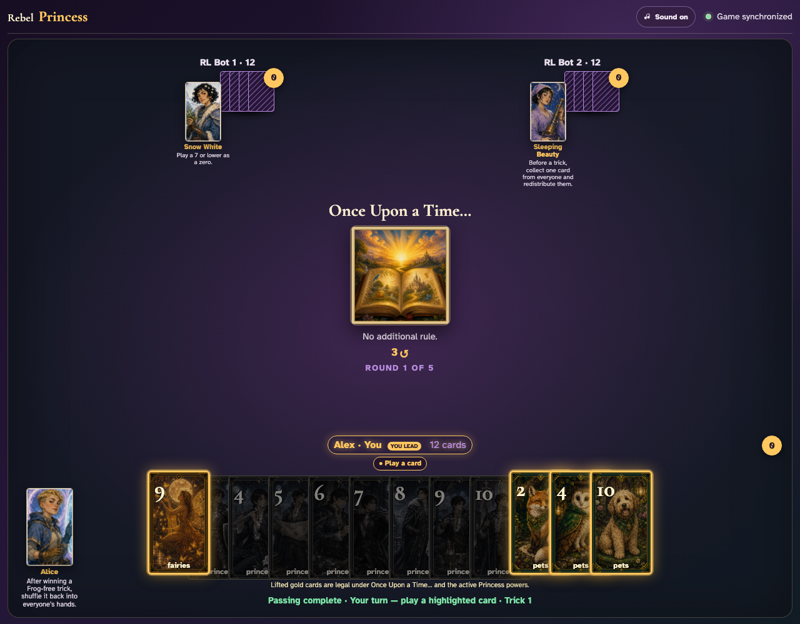
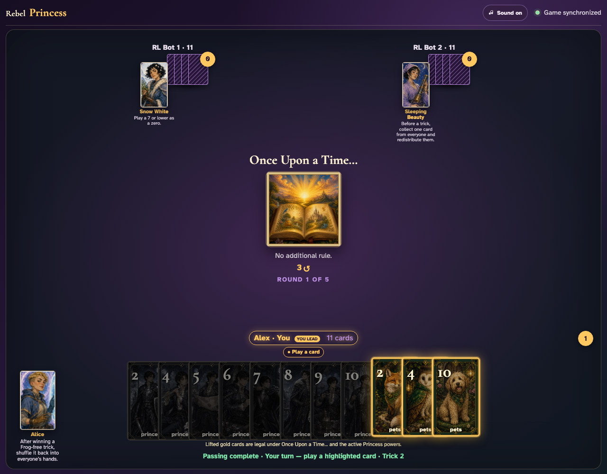
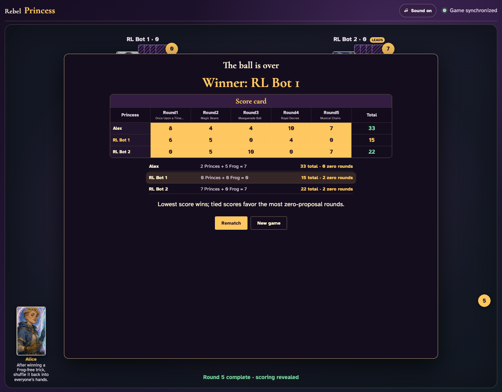

# Playable reinforcement-learning bots

A human host fills an otherwise empty room with two independently authenticated RL bots, reloads their controllers, and finishes all five rounds with them.

## Two trained bots join and seal their own Princess choices

**Verifications:**
- [x] The guest list contains one human and two separately named RL bots
- [x] Every seat is ready after the bots complete sealed Princess commit and reveal
- [x] Both live controllers report that they are waiting for gameplay

---

## The learned policy passes cards and plays whenever its seat owns the action

**Verifications:**
- [x] The simultaneous pass resolves without either bot retracting its submission
- [x] The human receives a playable turn after autonomous bot decisions
- [x] Every seat still owns exactly twelve cards after the conserved pass

---

## Reloading the host reconstructs both bot controllers without changing the game

**Verifications:**
- [x] Both independently authenticated bot controllers are restored
- [x] The host returns to the same playable turn with the same twelve-card hand
- [x] Both bot seats remain present after replay

---

## The recovered bots finish the first trick and advance to the next human decision

**Verifications:**
- [x] The table advances to trick two without another human driving the bot seats
- [x] The human played exactly one card in the completed trick
- [x] Both independently controlled bot seats remain at the table

---

## The recovered learned bots finish all five rounds with the human host

**Verifications:**
- [x] Every one of the five rounds has an immutable score column
- [x] All 180 dealt cards were legally played through the shared stream
- [x] The game reports a final winner or shared victory
- [x] Both recovered bot controllers remain healthy at game end

---
