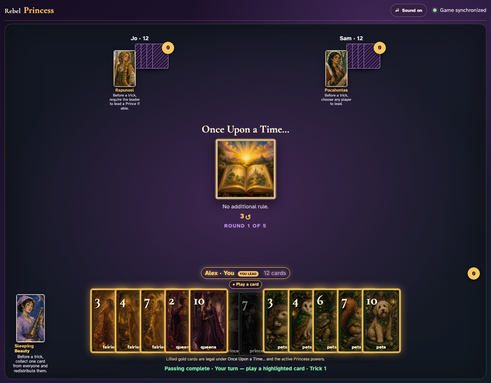
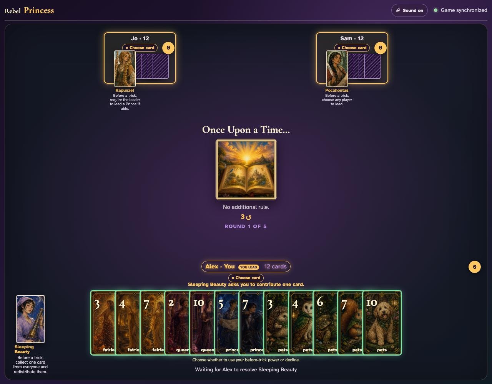

# Leader fallback for before-trick powers

A leader who did not raise a hand during passing may still invoke Sleeping Beauty before playing, which opens rolling priority for every eligible player.

## The unsignaled leader may either lead a card or invoke Sleeping Beauty

**Verifications:**
- [x] Sleeping Beauty remains enabled after the hand-raise window closes
- [x] Ordinary lead cards remain playable because no player requested priority in advance
- [x] The table identifies Alex as the current leader

---

## Invoking Sleeping Beauty opens and owns the rolling-priority window

**Verifications:**
- [x] Every player is prompted to contribute exactly one card
- [x] No lead card can be played while Sleeping Beauty resolves
- [x] The event-backed collection control replaces the local Begin button

---
