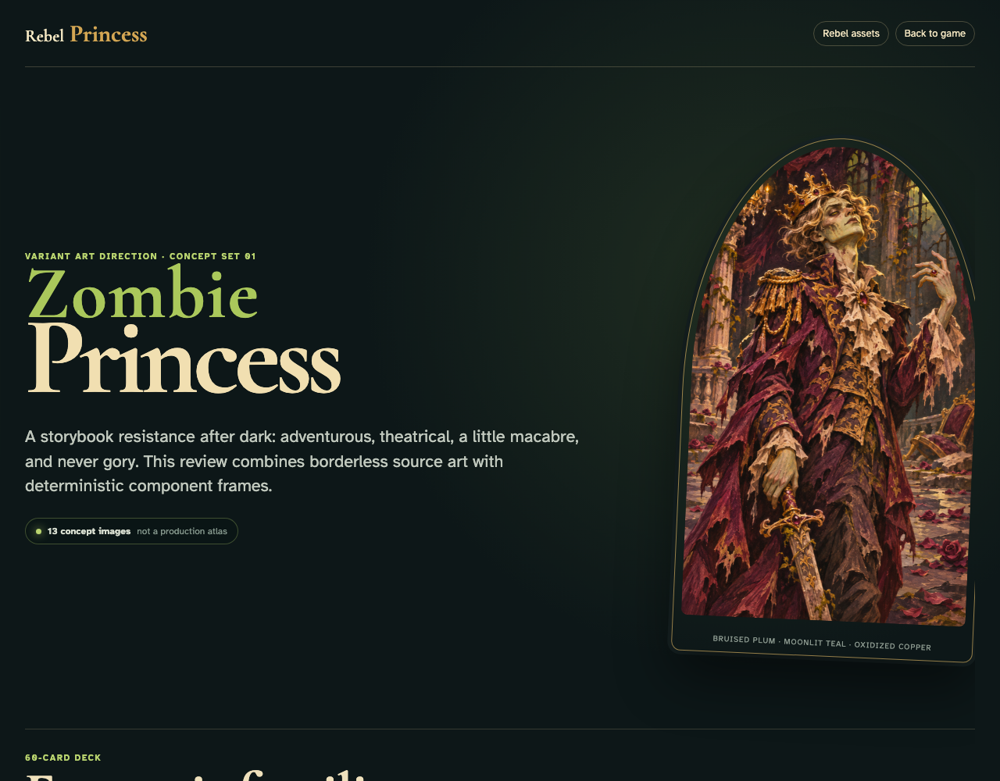

# Zombie Princess component study

Review the proposed playing suits, Frog, Princesses, round cards, tokens, bidding controls, and shared-table phase language before production art or game logic is implemented.

## The complete concept set remains readable in the desktop viewport

**Verifications:**
- [x] The route identifies all 13 concept images as a non-production set
- [x] All four playing suits use the shared playing-card frame
- [x] The Frog is correctly identified as the special Pet 6
- [x] Three Princess powers and three round-card treatments are visible
- [x] Bidding, skull economy, and phase-order UI studies are present
- [x] Every concept image has loaded at its intrinsic dimensions

---
