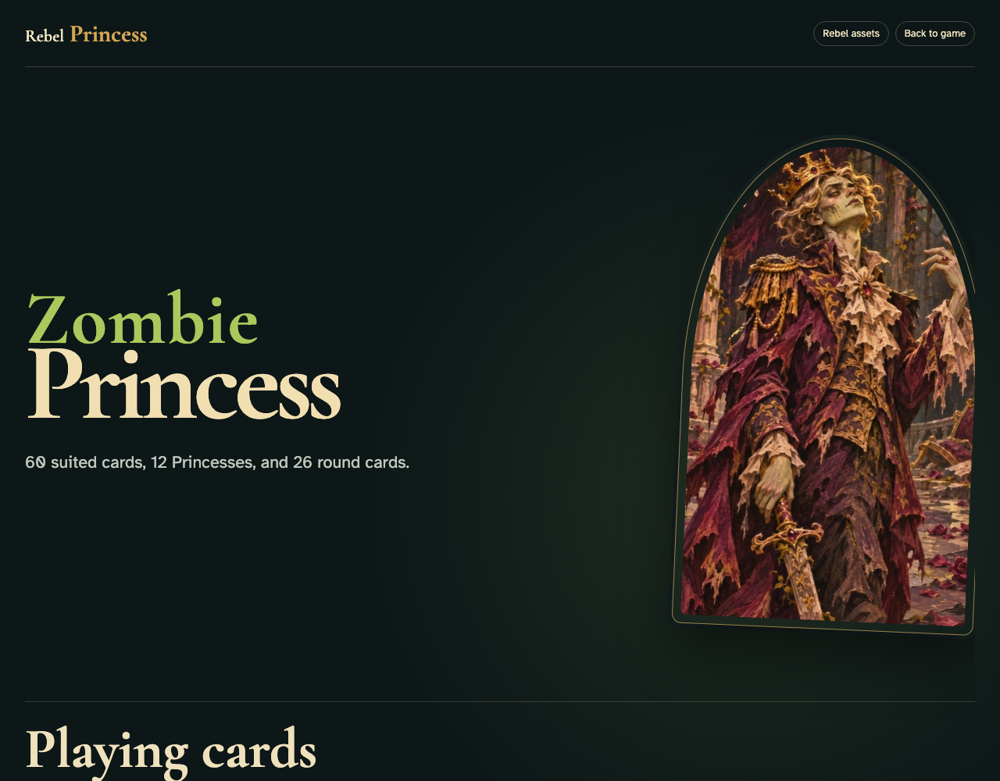

# Zombie Princess complete asset review

Review all 60 suited cards, 12 Princesses, 26 round cards, tokens, bidding controls, and shared-table phase language before game logic is implemented.

## The complete asset set remains readable in the desktop viewport

**Verifications:**
- [x] The complete Zombie Princess gallery is present
- [x] All 60 suited cards use the shared playing-card frame
- [x] The Frog is correctly identified as the special Pet 6
- [x] All 12 Princesses and all 26 round cards are present
- [x] Every Princess portrait is fully contained without cropping
- [x] All 26 verified pass instructions match the printed A–Z sequence
- [x] Bidding, skull economy, and phase-order UI studies are present
- [x] Every asset has loaded at its intrinsic dimensions

---
